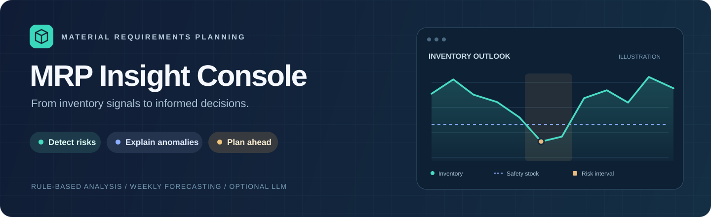
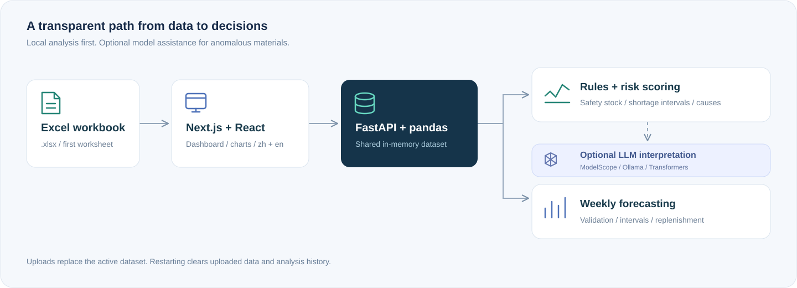
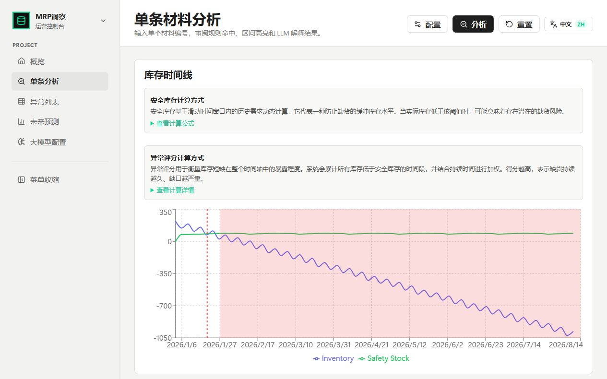
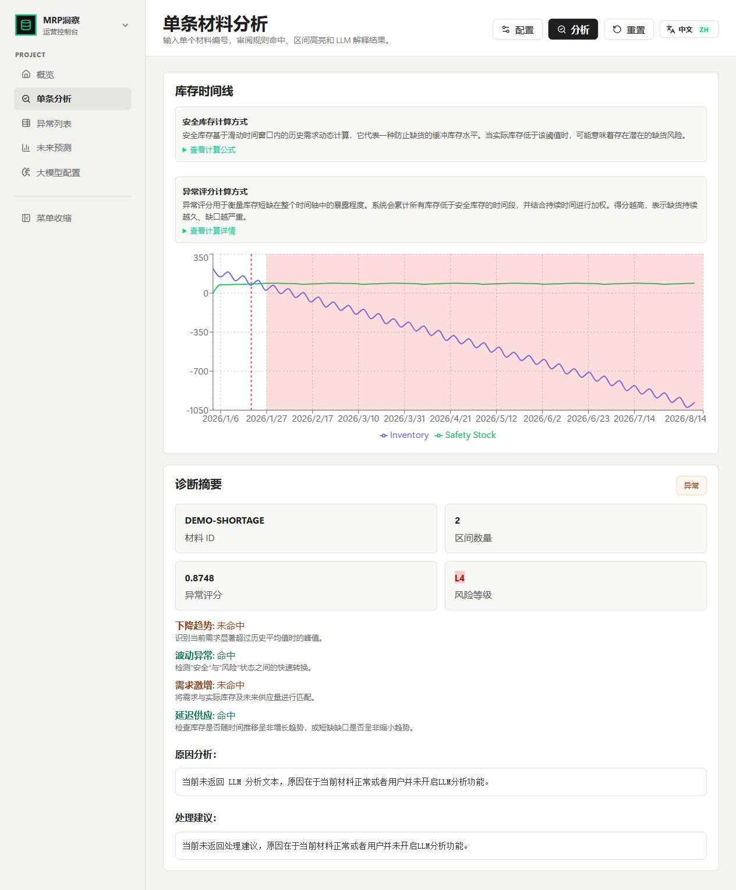
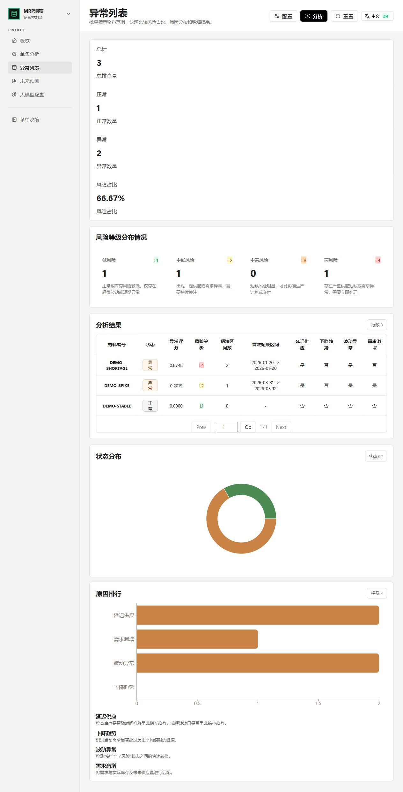
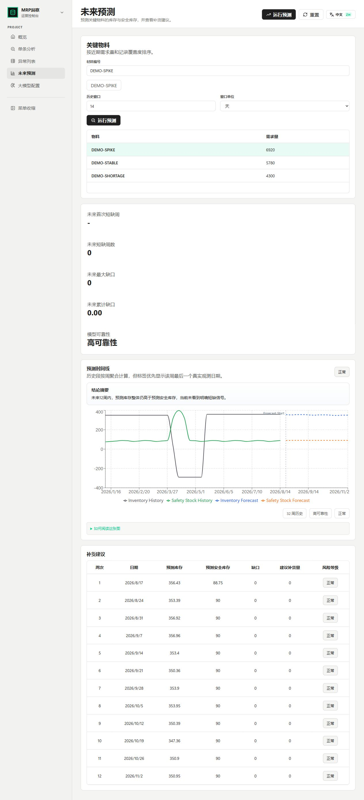

<div align="center">



# MRP Insight Console

**A local workspace for material requirements planning, inventory diagnostics, and forecasting.**


[](../LICENSE)

[中文](../Readme.md) · [Quick start](#quick-start) · [Data format](#data-format) · [Publication review](PUBLISHING.md)

</div>

Import an Excel workbook, inspect inventory and safety-stock curves, identify shortage intervals, and review weekly forecasts. Optional LLM interpretation is available through ModelScope, Ollama, or local Transformers. Rule-based analysis, batch screening, and forecasting do not require a cloud API key.

## ✨ Features

| Capability | What it provides |
| --- | --- |
| Data overview | Material, record, and plant counts, date coverage, and recent analysis history |
| Single-material diagnostics | Inventory curves, dynamic safety stock, shortage intervals, and risk scores |
| Rule-based causes | Gradual shortage, inventory fluctuation, demand spikes, and delayed supply |
| Batch screening | Material-prefix and status filters, cause distributions, and risk-ranked results |
| Weekly forecasts | The UI forecasts 12 weeks; the API accepts 1–52 weeks. Includes rolling validation, optional seasonal selection and ensembling, prediction intervals, and replenishment suggestions |
| Optional LLM interpretation | Explanations and recommendations for anomalous materials in single-material analysis |
| Bilingual interface | Chinese / English UI and a separate LLM output-language setting |



**Single-material diagnostics · synthetic shortage scenario**



<details>
<summary><b>More screenshots: diagnostics, batch screening, and forecasts (Chinese UI)</b></summary>







</details>

The cover chart is an illustration. The included demo workbook contains synthetic data only. Forecasts and model recommendations need business review.

<a id="quick-start"></a>

## 🚀 Quick start

Use **Python 3.10+** (an isolated Python 3.11 environment is recommended), **Node.js 20.9+**, and npm. The commands below use Windows PowerShell and start in the project root.

```powershell
python -m venv .venv
.\.venv\Scripts\Activate.ps1
python -m pip install --upgrade pip
python -m pip install -r requirements.txt
cd frontend
npm ci
npm run build
cd ..
python -m backend.main
```

The Python requirements file is at the **repository root**. It includes local-model dependencies such as PyTorch and Transformers, so the complete installation can be large. For NVIDIA GPUs, install a PyTorch build compatible with your driver and CUDA environment first.

The launcher serves `frontend/out/` and opens **http://127.0.0.1:8000**. Interactive API documentation is at **http://127.0.0.1:8000/docs**. Rebuild the frontend after changing its source. There is no need to install the root-level Node dependencies for this workflow.

On macOS / Linux, activate with `source .venv/bin/activate`. Windows executable packaging and the current shutdown behavior require separate adaptation and validation on other platforms.

### Try the demo

1. Select [sample_mrp.xlsx](../examples/sample_mrp.xlsx) using **Import Data**, then click **Analyze** to upload it.
2. Confirm the overview shows three materials and one plant.
3. Open **Single Analyze**, click **Configuration**, enter `DEMO-SHORTAGE`, disable deep LLM analysis, and run it.
4. Open **Exception Lists** (batch analysis) and click **Analyze** to compare `DEMO-STABLE`, `DEMO-SHORTAGE`, and `DEMO-SPIKE`.
5. Open **Forecast** and select a key material to generate the default 12-week forecast and replenishment suggestions.

The workbook contains 195 records covering 32 weeks. See [the example guide](../examples/README.md) to regenerate it. It demonstrates the workflow and is not an accuracy benchmark.

Uploads replace a shared in-memory dataset. Restarting clears uploaded data and recent analysis history. Stop a source-run server with `Ctrl+C`. The frontend currently also sends a shutdown request on page unload; see [runtime limitations](PUBLISHING.md#runtime-limitations) before distributing a packaged application.

<a id="data-format"></a>

## 📄 Data format

The backend reads the **first Excel worksheet** with `pandas.read_excel`. Use `.xlsx`. The file picker currently accepts CSV, but the backend does not parse it; convert CSV files to Excel first.

| Required column | Meaning | Example |
| --- | --- | --- |
| `Material Number` | Material identifier; use Excel text cells to preserve leading zeros | `DEMO-STABLE` |
| `plant_id` | Plant identifier | `DEMO-PLANT` |
| `mrp_element_receipt_or_requirement_date` | Event date; ISO dates are recommended | `2026-01-05` |
| `Mrp Element Short Name` | An event recognized by the rule engine | `Stock`, `Order`, `PurRqs` |
| `Qty` | Numeric quantity; positive receipts, negative requirements | `500`, `-80` |

Column names are case-sensitive at upload; surrounding whitespace is trimmed. `Stock` resets the inventory baseline. Event semantics come from [MRP_ELEMENT_MAP](../backend/data_local_window.py); verify your ERP export against this mapping. Unknown events are not automatically interpreted.

Some missing identifiers and dates are forward-filled. Keep material records together and clean dates and quantities before upload. Each material needs at least two records. Forecast quality depends on history length and data quality; short histories may use a simple fallback model.

**Analysis groups by material identifier, not by plant.** Filter to one plant or use unique material identifiers when the same material occurs at multiple plants.

## 🧠 Optional LLM configuration

Open **LLM Settings**, enable deep analysis, choose a provider and output language, save the settings, and test the provider. Confirm the switch in **Single Analyze** before running.

| Provider | Setup |
| --- | --- |
| ModelScope API | Supply an Access Token, a usable model ID, and a Base URL; default: `https://api-inference.modelscope.cn/v1/` |
| Ollama | Start Ollama, pull a model (for example `ollama pull qwen2.5:7b`), and configure the host; default: `http://localhost:11434` |
| Local Transformers | Provide reviewed model files, suitable hardware, device settings, and dtype; `float32` is generally suitable for CPU execution |

Interactive single-material analysis calls the model only when enabled and an anomaly is detected. The batch API runs rules without LLM calls; the forecast API uses statistical models. Cloud interpretation sends material sequence data and analysis context to the configured provider, so enable it only for approved data.

Saved fields in `llm_config.json` override environment defaults, which override built-in defaults. The backend does not automatically load a root `.env` file. Before saving UI configuration, environment variables can provide initial settings:

```powershell
$env:MODELSCOPE_ACCESS_TOKEN = "<your-token>"
$env:BASE_URL = "https://api-inference.modelscope.cn/v1/"
$env:MODEL = "<model-id>"
python -m backend.main
```

Other variables include `LLM_PROVIDER`, `LLM_LANGUAGE`, `OLLAMA_HOST`, `OLLAMA_MODEL`, and `LOCAL_LLM_MODEL_PATH`; see [llm_config.py](../backend/llm_config.py) for all defaults.

Credentials are stored in plaintext in the ignored `llm_config.json`. The settings API masks saved keys, but the application has no built-in authentication or roles. Keep it local until access controls have been added. A local Transformers connection test checks files and imports, not a complete model inference.

## 🛠️ Development and packaging

Run the backend in one terminal:

```powershell
python -m uvicorn backend.app:app --host 127.0.0.1 --port 8000 --reload
```

Run the frontend in a second terminal:

```powershell
cd frontend
npm run dev
```

Open **http://localhost:3000**. Upload and shutdown components currently use fixed local addresses, so changing the typed API client's base URL alone does not enable remote deployment.

After building the frontend, the existing Windows packaging entry point is:

```powershell
pyinstaller main.spec
```

It bundles `frontend/out/` into `dist/main.exe`. Validate the executable on a clean target Windows system before distribution. Full executable packaging was not verified during this documentation update.

To exercise the rolling forecast backtest:

```powershell
python -m backend.forecast_backtest --data-path examples/sample_mrp.xlsx --horizon-weeks 4 --min-history-weeks 8 --max-materials 3
```

Use `--output-json <path>` to export results. Use independent historical business data for accuracy evaluation.

## ❓ Troubleshooting

| Symptom | Check |
| --- | --- |
| Missing frontend or 404 | Build in `frontend` and verify `frontend/out/index.html` exists before restarting |
| Empty dashboard | Select an Excel file and click **Analyze** to upload it |
| Missing columns / parse failure | Check the five column names, numeric quantities, and first worksheet; use `.xlsx` |
| `str \| None` type error | Use Python 3.10+ and the intended virtual environment |
| NumPy / pandas binary incompatibility | Install dependencies in a clean virtual environment rather than mixing old Conda packages |
| API requests fail | Verify the local backend is running on port `8000` and check proxies / port conflicts |
| No LLM result for a normal material | Expected: only enabled analysis of anomalous materials calls the model |
| Local inference fails after a successful test | Check actual model loading, memory, device compatibility, and dtype |

For a source map, see [PROJECT_FILES.md](../PROJECT_FILES.md). This project is distributed under the [MIT License](../LICENSE).
